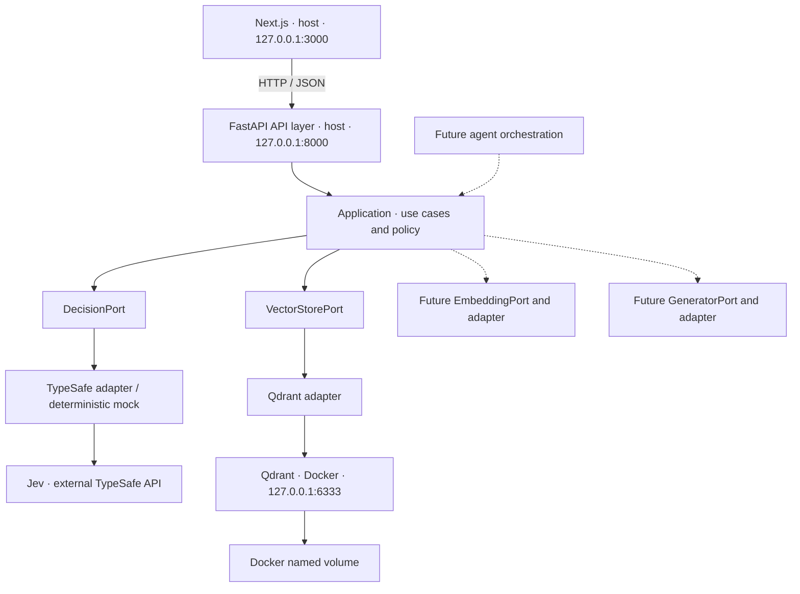

# FND-002 – System architecture

Status: recorded decision. Pattern: modular monolith with port/adapter boundaries.

## Components and execution

The diagram shows the logical target architecture. A single backend coordinates workflows, without a separate API gateway, service discovery, message queue, or distributed transaction.

| Execution location | Component | Requirement |
| --- | --- | --- |
| Host | Python + uv + FastAPI | Project-local virtual environment, `127.0.0.1:8000` |
| Host | Node.js LTS + pnpm + Next.js | Project dependencies, `127.0.0.1:3000` |
| Docker Compose | Qdrant | Specific image version, `127.0.0.1:6333:6333`, named volume |
| External service | Jev / TypeSafe | Exclusively through the backend adapter, asynchronous calls |

The initial plan specifies Python `3.14.8`. Runtime availability and package compatibility must be verified when initializing FND-008. This document does not establish that a runtime is installed or tested. The relevant initialization task records specific version pins for Node.js/pnpm, Python packages, and the Qdrant image, without `latest` or floating SDK model aliases.

## Layers and dependency direction

| Layer | Responsibility | Allowed dependencies |
| --- | --- | --- |
| Next.js | Presentation, interaction, backend diagnostics | Backend HTTP contract |
| API | Routing, request/response validation, HTTP errors, request ID | Application, internal types |
| Application | Use cases, workflow, deterministic policy | Domain and ports |
| Domain / Ports | Provider-independent types, interfaces, and errors | Own types, no SDKs |
| Infrastructure / Adapters | Access to Jev, Qdrant, and future providers | Domain/ports and the relevant SDK |
| Composition root | Configuration, adapter selection, dependency injection, and lifespan | Wiring the layers above |

Planned backend module location: `apps/api/src/jev_rag/{api,application,domain,ports,adapters,core}`. These are target locations, to be created by the backend tasks. The application does not import infrastructure SDKs. Adapters do not make workflow decisions. The composition root supplies adapters through ports.

The frontend receives neither a TypeSafe API key nor direct Qdrant access. The future Next.js server-side API client also calls FastAPI. The frontend server-side layer does not become a second orchestration layer.

## Roles of decisions, retrieval, and generation

| Component | Role |
| --- | --- |
| Jev | Structured decision input for routing, classification, and relevance evaluation |
| Qdrant | Semantic retrieval of document chunks |
| Generative LLM | Produce natural-language answers from supplied sources |
| FastAPI application | Authorization, policy, coordination of steps, and execution |

Jev Choice, Score, and Noul results are decision data that application code can process. The [TypeSafe introduction](https://docs.typesafe.ai/introduction) also distinguishes this role from text generation. A model response alone does not grant execution permission.

In the future RAG workflow, ingestion produces embeddings and index entries. The question-answering use case coordinates retrieval, Jev evaluation when needed, and generation. FND-001–004 define only responsibility boundaries for these capabilities. No specific embedding model, generative LLM, or agent framework has been selected yet.

## Lifecycle, errors, and security boundaries

The backend validates configuration at startup, reuses asynchronous clients per worker process, and closes them at shutdown. The Jev client is not initialized in mock mode. Missing credentials in live mode are a configuration error. The system must not silently switch to mock mode.

Liveness checks only the backend process. Readiness checks the required Qdrant connection within a bounded time. A Jev outage alone does not cause readiness to fail. The [interface contract](interface-contracts.md) defines the exact HTTP responses.

Public diagnostics contain no keys, connection strings, or stack traces. Structured logs can be correlated by request ID and contain no raw state, user content, or provider response body. In a multi-user system, authorization is the application's responsibility. The vector store filter only enforces the verified scope.

Future agents receive tool access only through application use cases, with the same validation, authorization, and policy. Agent orchestration does not belong in SDK adapters. Production scaling and availability require a separate decision.

## Acceptance

FND-002 is complete: components, responsibilities, dependency directions, execution locations, and future extension boundaries are recorded. The related storage decision is [ADR-001](../adr/ADR-001-vector-store.md), and phase boundaries are defined in the [Foundation scope](../foundation/scope.md).
