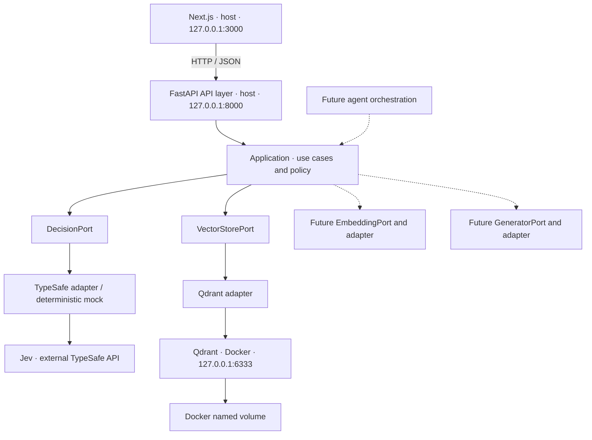

# FND-002 – Rendszerarchitektúra

Állapot: rögzített döntés. Minta: moduláris monolit, port/adapter határokkal.

## Komponensek és futtatás

A diagram logikai célarchitektúra. Egyetlen backend koordinálja a folyamatokat, nincs külön API gateway, service discovery, üzenetsor vagy elosztott tranzakció.

| Futtatási hely | Komponens | Követelmény |
| --- | --- | --- |
| Host | Python + uv + FastAPI | Projektlokális virtuális környezet, `127.0.0.1:8000` |
| Host | Node.js LTS + pnpm + Next.js | Projektfüggőségek, `127.0.0.1:3000` |
| Docker Compose | Qdrant | Konkrét image-verzió, `127.0.0.1:6333:6333`, named volume |
| Külső szolgáltatás | Jev / TypeSafe | Kizárólag backend adapterből, aszinkron hívások |

A kiinduló terv Python `3.14.8`-at jelöl. A runtime tényleges elérhetőségét és a csomagkompatibilitást az FND-008 inicializálásakor ellenőrizni kell. Ez a dokumentum nem igazol telepített vagy tesztelt runtime-ot. A Node.js/pnpm, a Python-csomagok és a Qdrant image konkrét verziópinjeit az illetékes inicializálási feladat rögzíti, `latest` és lebegő SDK-modellalias nélkül.

## Rétegek és függőségi irány

| Réteg | Felelősség | Megengedett függőség |
| --- | --- | --- |
| Next.js | Megjelenítés, interakció, backend-diagnosztika | Backend HTTP-contract |
| API | Routing, request/response validáció, HTTP-hibák, request ID | Application, belső típusok |
| Application | Use case-ek, workflow, determinisztikus policy | Domain és portok |
| Domain / Ports | Providerfüggetlen típusok, interfészek és hibák | Saját típusok, SDK nélkül |
| Infrastructure / Adapters | Jev, Qdrant és későbbi szolgáltatók elérése | Domain/portok és az adott SDK |
| Composition root | Konfiguráció, adapterválasztás, dependency injection és lifespan | A fenti rétegek összekötése |

A tervezett backendmodulok helye: `apps/api/src/jev_rag/{api,application,domain,ports,adapters,core}`. Ezek célhelyek, létrehozásuk a backendfeladatok része. Az application nem importál infrastruktúra SDK-t. Az adapter nem hoz workflow-döntést. A composition root a portokon keresztül adja át az adaptereket.

A frontend nem kap TypeSafe API-kulcsot vagy közvetlen Qdrant-hozzáférést. A későbbi Next.js szerveroldali API-kliens is a FastAPI-t hívja. A frontend szerveroldali rétege nem válik második orchestration réteggé.

## A döntés, retrieval és generálás szerepe

| Komponens | Szerep |
| --- | --- |
| Jev | Strukturált döntési bemenet routinghoz, osztályozáshoz és relevanciaértékeléshez |
| Qdrant | Dokumentumrészletek szemantikus visszakeresése |
| Generatív LLM | Természetes nyelvű válasz előállítása a kapott forrásokból |
| FastAPI application | Jogosultság, policy, lépések koordinálása és végrehajtás |

A Jev Choice, Score és Noul eredményei az alkalmazáskód által feldolgozható döntési adatok. Ezt a szerepet a [TypeSafe bevezetője](https://docs.typesafe.ai/introduction) is elkülöníti a szöveggenerálástól. Egy modellválasz önmagában nem ad végrehajtási jogosultságot.

A későbbi RAG-folyamatban az ingestion embeddinget és indexbejegyzéseket készít, a kérdés-válasz use case retrievalt, szükség esetén Jev-értékelést és generálást koordinál. Ezek az FND-001–004-ben kizárólag felelősségi határok. Konkrét embeddingmodell, generatív LLM és agent framework még nincs kiválasztva.

## Életciklus, hibák és biztonsági határok

A backend a konfigurációt induláskor validálja, workerfolyamatonként újrafelhasználja az aszinkron klienseket, leállításkor lezárja őket. Mock módban a Jev-kliens nem inicializálódik. Live módban a hiányzó hitelesítő adat konfigurációs hiba, a rendszer nem válthat csendben mockra.

A liveness csak a backend folyamatot ellenőrzi. A readiness a kötelező Qdrant-kapcsolatot vizsgálja határolt időn belül, Jev-kiesés önmagában nem teszi sikertelenné. A konkrét HTTP-válaszokat az [interfészszerződés](interface-contracts.md) rögzíti.

A publikus diagnosztika nem tartalmaz kulcsot, connection stringet vagy stack trace-t. A strukturált logok request ID-val korrelálhatók, nyers state, felhasználói tartalom és provider response body nélkül. A többfelhasználós rendszerben az autorizáció az application feladata, a vector store filtere csak végrehajtja az ellenőrzött hatókört.

Jövőbeli agent csak application use case-en keresztül kap eszközhozzáférést, azonos validációval, jogosultsággal és policyval. Agent orchestration nem kerül SDK-adapterbe. Production skálázás és rendelkezésre állás külön döntést igényel.

## Elfogadás

Az FND-002 teljesült: a komponensek, felelősségek, függőségi irányok, futtatási helyek és későbbi bővítési határok rögzítettek. A kapcsolódó tárolási döntés az [ADR-001](../adr/ADR-001-vector-store.md), a fázishatár a [Foundation scope](../foundation/scope.md).
